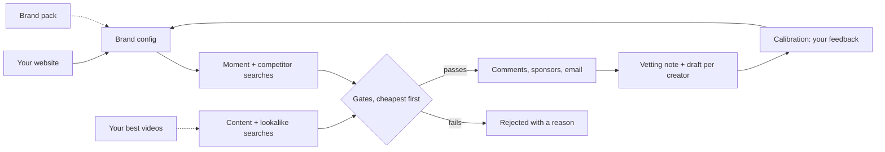

# YouTube Creator Sourcing

**Drop your website. Get a vetted shortlist of YouTube creators, with a first message drafted for each.**
Claude researches your brand, finds creators in your niche and market, checks their views, their
comments and who they already work with, and leaves a vetting note and a ready-to-edit first
message per creator. **It never sends anything.** You review, edit and send.

Built for people who run creator partnerships: brand-side managers, founders doing influencer
marketing themselves, and agencies sourcing for a client.

---

## What you get

| | |
|---|---|
| **Starts from your website** | You give one URL. Claude proposes your markets, competitors, search phrases and thresholds; you correct them |
| **Three ways to find creators** | Searches for the moments your product matters, reviews of your competitors, and lateral searches from your own best videos |
| **Learns from your results** | Share your 5-10 best videos and their results. It searches next to their real titles and for lookalikes of the creators who made them, free. An optional transcript mode adds variations Claude writes from the transcripts. Only the last 180 days count, and it rotates run to run |
| **Knows your brand** | Drop in your ICPs, brand guidelines and what works. Claude turns them into a brief that shapes the searches, the vetting and the drafts |
| **Runs free** | Keyless out of the box. With a free YouTube API key (10 minutes): twice the depth, 4 runs a day at no cost, and a guard that keeps you inside the free quota |
| **Audience geography** | An estimate of where each creator's audience is (UK, US, Canada, a city like London) from commenter countries, comment times and local words, with a confidence. You set the target |
| **Comment check** | Up to 100 comments on a relevant video: real questions or generic praise, whether the creator replies, how many commenter accounts are brand new |
| **Sponsorship history** | Which competitors a creator has worked with, how often and how recently, from the last 50 uploads |
| **Email-first contact** | Addresses the creator published, each stored with its source. None is ever guessed |
| **A score you can read** | 0 to 100, every point explained. Comments carry the most weight |
| **Vetting note and draft** | A verdict with reasons, the videos worth opening, and a first message that references the creator's own video |
| **20-minute calibration** | After your first run you review the calls on one page; the engine is tuned to your judgment |
| **Safe by design** | Never sends. Creator pages treated as untrusted. Claude never sees your key. Everything stays on your computer |

## How it works (30 seconds)



The full explanation, including how lateral search works and how it stays current:
[docs/HOW-IT-WORKS.md](docs/HOW-IT-WORKS.md).

---

## Get started

**Start with your website. Go deeper when it pays.** Each level is optional and can come before
your first run or after it.

| Level | You give | Time | What it adds |
|---|---|---|---|
| **1. Quick start** | Your website | 10 min + the run | A first shortlist the same day, keyless |
| **2. Full engine** (recommended) | A free YouTube API key | +10 min, once | Twice the depth, commenter check, 4 free runs a day |
| **3. Knows your brand** | ICPs, guidelines, what works | +15-30 min | Searches, vetting and drafts shaped by who you speak to |
| **4. Learns from your results** | Your 5-10 best videos with results | +10-20 min, monthly | Content variations and creator lookalikes from what already works |

### What you need

- **Claude Code**, in the Claude desktop app (Code tab) or the terminal.
  [Install guide](https://code.claude.com/docs/en/setup).
- **A Mac, Linux, or Windows with WSL**, and Python 3.9 or newer.
- Optional: a free **YouTube Data API key** ([10-minute guide](docs/youtube-api-key.md)), a
  **Serper** key for a missing email, a **ScrapeCreators** key for transcripts.

### Install (3 minutes)

Either:

- **Download it (easiest).** On the repo page, click the green **Code** button, then
  **Download ZIP**. Unzip it and move the folder somewhere you'll find it.
- **Or clone it** with git:

  ```bash
  git clone https://github.com/hakon-junge/youtube-creator-sourcing.git
  ```

Then, in that folder:

```bash
bash setup.sh
```

### Hand it to Claude

Open the folder in Claude Code and paste:

```
Set up YouTube creator sourcing for my brand. My website is: https://your-site.com
```

Claude asks whether you want the quick start (keyless) or the free API key, proposes your setup
from your website, runs the engine, vets every creator, writes the drafts and opens the
calibration page. Every stage in plain words: [docs/SETUP.md](docs/SETUP.md).

### After that

| Say | What happens |
|---|---|
| `Run the YouTube sourcing for <brand>` | A new run; only new channels cost anything |
| `What should I set up next?` | The next level and what it adds |
| `Add my YouTube API key` / `Add my brand docs` / `Import my best videos` | Levels 2, 3, 4, guided |
| `Is everything set up?` | `doctor.py`: keys, setup path, brand context, seeds, calibration |

---

## What a run costs

Nothing, inside the free quota. Google gives every API key 10,000 units a day. A run uses up to
2,400: each search costs 100 units, each channel about 3, each comment check about 3. The engine
allows four runs a day and stops using the API at 9,600 units, falling back to public pages for
the rest of the run. A typical run reads a few hundred channels and deep-checks 10-30 of them for
roughly 300-900 units with the default keyless search; switching search to the API costs 100 units
a search on top.

## What it reads, and what it does not

- It reads **public** YouTube data through the official API or public pages. It never logs in.
- It cannot see who watches a video. Commenters are the visible part of an audience.
- A channel's country is what the creator set. Without one, geography is estimated from the about
  text and titles, and an unclear channel is flagged for you to check.
- The business email on a channel's About tab sits behind a captcha and is not read. Only
  addresses the creator wrote in public text are found.
- Sponsorship is read from descriptions of the last 50 uploads; an undisclosed deal is invisible.
- Transcripts need the optional ScrapeCreators key (one credit per video, top channels only).

## Your data

Everything stays on your machine: `out/` (run results), `crm/` (notes, drafts, contact sheet),
`state/` (what has been seen, view snapshots, the credit ledger), `brand/` (your brand pack and
brief), `seeds/` (your imported top creators) and your brand config. All of it is git-ignored, and
the project settings stop Claude from reading or editing `.env`. Creator emails are public addresses the creators published for
collaborations; each is stored with its source. They are still personal data, so keep outreach
one-to-one and follow the rules that apply where you and the creator are.

## Files

```
README.md               this file
docs/SETUP.md           the full setup guide, level by level
docs/HOW-IT-WORKS.md    how it finds, checks, scores and stays current
docs/youtube-api-key.md how to create and test the free YouTube API key
.claude/settings.json   permissions: the engine's commands allowed, the key file denied
CLAUDE.md               the engine's rules, for Claude
.claude/skills/         the creator-sourcing-youtube skill: the guided procedure
setup.sh  doctor.py     install and setup check
set_key.py              paste a key privately into .env, then test it
new_brand.py            scaffold a brand from its website
import_seeds.py         import your best videos or creators: profiles + content pack for lateral search
run_brand.sh            one run: discovery, gates, comment check, handoff
phase1.py phase2.py phase3.py   the stages run_brand.sh calls
regate.py               re-apply the gates to a past run, free
calibrate.py            build the calibration page
config/_template.yml    every setting, with comments
stage5/_template_build.py       the verdict-and-draft file Claude fills per run
engine/                 gates, scoring, email ladder, comment check, quota guard, YouTube data layer
calibration/template.html       the calibration page
scripts/leak-scan.sh    checks no brand or creator name is about to be committed (patterns in .leak-patterns.local)
tests/                  offline checks of the skill, settings, safety rules and engine
SECURITY.md  CONTRIBUTING.md  CHANGELOG.md  CODE_OF_CONDUCT.md
```

## Troubleshooting

| Symptom | What to do |
|---|---|
| The log says the quota cap was reached | Normal near the end of a large run; the engine finished on public pages. Use fewer searches to stay on the API |
| Keyless reads fail | `.venv/bin/pip install -U yt-dlp` |
| Almost everyone rejected on geography | The home markers in your config are too narrow. Ask Claude to show the rejected bios and widen them with you |
| Few creators found | Add searches to `lanes.keyword`, phrased the way a viewer would type them, and include your market |

## You are the sender

Every draft is a suggestion. You read it, you decide, and anything you send is yours. The tool is
provided as-is under the MIT licence, with no warranty and no guarantee that a verdict, an audience
estimate or a draft is correct. Security and privacy in detail: [SECURITY.md](SECURITY.md).

## Support

Maintained by a small team, best effort. **Supported today:** macOS, in Claude Code. Linux and
Windows (WSL) should work but are less tested. Bugs and setup problems go in
[Issues](../../issues/new/choose), questions and ideas in [Discussions](../../discussions). We read
everything and fix what affects the most people first; we can't offer one-to-one setup help or
response times.

## Feedback

- **Something broken?** [Open an issue](../../issues/new/choose) with the "Bug" template.
- **A creator passed or rejected wrongly, or a draft that wasn't good enough?** Use the
  "Shortlist quality" template, with fictional or redacted examples. This is how the sourcing
  improves for everyone.
- **A security problem?** Report it privately: see [SECURITY.md](SECURITY.md).
- If this saves you time, a star helps other partnership people find it.

Maintained by [Fluencrs](https://github.com/hakon-junge). See [CONTRIBUTING.md](CONTRIBUTING.md).
Licensed [MIT](LICENSE).
