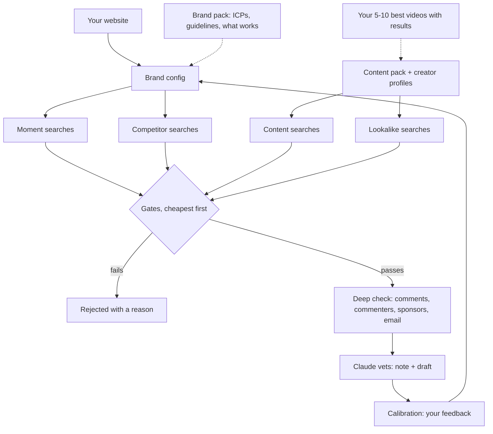

# How it works

The short version: **it finds creators four ways, checks them cheapest-first, explains every
point of the score, lets Claude vet the ones that pass, and keeps learning from your corrections
and your latest results.** Nothing is ever sent.

---

## 1. Four ways to find creators

Every run starts with searches. Each video that comes back brings its channel in as a candidate,
and that video is its **entry video**, the reason it was found.

| Lane | What it searches | Why it works |
|---|---|---|
| **Moment searches** (`keyword`) | The phrases your buyer types when your product matters, with your market in them ("repotting a monstera uk", "why are my plant leaves turning yellow uk") | Finds creators who teach or show your buyer something at the right moment |
| **Competitor searches** (`competitor_collab`) | "<competitor> review" for each direct and indirect competitor | Finds creators your category already pays. Work for a direct competitor is the strongest audience signal there is: flagged for exclusivity, never rejected |
| **Content searches** (`content`) | Variations on your best-performing videos, written by Claude from their transcripts | Finds creators making the type of content that already drove your results |
| **Lookalike searches** (`lookalike`) | Descriptions of the creators who made those videos, plus peer creators commenting on their best video | Finds creators like the ones who already worked for you |

### Lateral search, in two dimensions

The last two lanes only run once you've imported your best videos (Level 4). In testing, lookalike finds passed the gates about twice as often as cold moment searches, searches
built from the real titles of top videos about four times as often, and channels found by more
than one lane most often of all.

**Dimension 1: the content.**

1. You share your 5-10 best-performing videos and their results. The importer ranks them by your
   results column and keeps only the last 180 days.
2. For each video it builds a content pack: title, description, tags, views and (with the optional
   ScrapeCreators key) the transcript.
3. **The real titles do most of the work.** Each top video's title becomes a short search ("my
   sunday plant care routine in a tiny flat" -> "sunday plant care routine tiny flat uk"). In testing,
   these found creators like your seeds about four times as often as cold searches, so they get
   the biggest share of the lateral budget.
4. **Optional, transcript mode** (needs a ScrapeCreators key): Claude reads each video's
   transcript and writes an angle, what the video is and why it worked, with search variations on
   that type of content. These went wider than the titles in testing (more big channels and other
   countries), so they run as a small exploration slot, and the transcripts also feed the vetting
   and the first message. The free default skips this and gives the whole budget to titles and
   lookalikes.
5. Videos rotate: a video used in the last 21 days waits, so run 1 explores your top videos and
   later runs the rest.

**Dimension 2: the creators.**

1. Each top creator gets a profile: the words in their last 50 titles, their size, country and
   format.
2. Claude writes who each creator is ("calm small-flat plant collector who films weekly care routines")
   as lookalike searches ("small flat plant collection tour uk"). Without Claude's descriptions the
   engine searches the creator's most frequent title words.
3. With an API key, the engine also reads the comments on each top creator's best video and pulls
   in commenters who are creators themselves, in your subscriber band: the same community.
4. **Every channel that passes the gates**, whichever lane found it, is compared with every top
   creator's profile: topic 60%, size 20%, country 10%, format 10%. A match of 0.35 or more is
   flagged ("lookalike of your top creator X: 0.62, shared: plant, repot, routine") and earns a
   small bonus in the score.

Your top creators themselves are never sourced; they are treated as existing partners. About 40%
of a run's searches are lateral when seeds exist, split by what tested best: in the free default
about 55% real titles and 45% lookalike searches; in transcript mode about 45% titles, 40%
lookalikes and 15% transcript variations (at least one). A lane that runs short hands
its searches to the others. Lateral finds are checked first because they pass far more often.

## 2. Gates, cheapest first

A channel stops at the first gate it fails, so the expensive checks only run on channels worth it.

| Order | Check | Cost with a key |
|---|---|---|
| 1 | **Title and niche**: off-topic, compilation, reaction or meme content; your own brand, a competitor, a seed | free |
| 2 | **Seen before**: a channel from an earlier run is skipped | free |
| 3 | **Channel record**: subscriber band, country, about text, "is this a company?" | 1 unit |
| 4 | **Upload history** (50 uploads, 15 keyless): still active, median views per format (long-form and Shorts never mixed), how much is on your topic, sponsorship history from descriptions | 2 units |
| 5 | **Geography**: a country set on the channel decides; without one, the about text and titles; unclear is flagged | free |
| 6 | **Email ladder**: the about text, video descriptions, the creator's link page, then (optional) one web search. Never guessed, every address carries its source | free |
| 7 | **Comment check** on the best scorers only: up to 100 comments, how many are real questions or specific reactions, whether the creator replies, how many commenter accounts are brand new | about 3 units |
| 8 | **Transcript** of the entry video (optional ScrapeCreators key) | 1 credit |

### Audience geography: where the audience is

YouTube shows a channel's audience countries only to its owner, so nobody else can read them,
including the paid audience tools. They estimate it, and so does this engine, for free, from four
independent signals:

| Signal | What it reads | Good for |
|---|---|---|
| Commenter countries | The country commenters set on their own channel (about 5% do, so it reads up to 150 commenters across 3 videos) | Country level, when enough are set |
| Comment times | When the audience comments, fitted to time zones and read at continent level | Ruling audiences out: Europe vs the Americas vs Asia-Pacific |
| Words and places | Country-specific words in comments: £, Tesco, NHS, council tax vs $, Walmart, 401k vs Woolies, Centrelink; place names | Country level, and the only signal for a city |
| The creator | The country set on the channel, the about text, place names in titles | A weaker prior |

Each note shows the estimate, a range and a confidence, with every source:

> Audience geography: estimate, medium confidence: about 81% in the UK (66-96%), target 50%:
> meets it. 5 of 5 commenters with a country on their channel are in GB; comment times fit Europe
> and Africa 100%; words and places in comments: the UK 20, the US 1; channel country GB.

You set the target in the config: the countries, the share (default 50%), and optionally a city
such as London or New York. A clear miss is flagged, or rejected if you choose; anything close or
low-confidence goes to human review with a reminder to ask for the creator's audience screenshot
before money moves. A city comes back as a signal ("London named in 6 comments and 3 titles"),
not a percentage. Only totals are kept, never anything per commenter.

Tested on channels with a known home country: a UK channel came out at about 98% UK, and US,
Canadian and Australian channels at 2-12% UK, all as misses for a UK target. Still being tuned: the comment-time
fit reads some late-night UK commenting as Asia-Pacific, which errs on the side of under-counting.

## 3. A score you can read

0 to 100, built from six parts, every point written out in the note:

| Part | Weight | What earns it |
|---|---|---|
| Audience | 25 | The comment check. Halved on a thin sample; almost no comments is a penalty |
| Views | 20 | Median views of recent long-form (or Shorts, by your choice) above your floor, a bonus above target |
| Relevance | 15 | Teaches or shows your buyer something on your topic, reduced when the topic is a side theme |
| Contact | 15 | A published email |
| Brand proof | 15 | Sponsorship history, especially with competitors |
| Geography | 10 | Audience in a market where people can buy |

Plus small bonuses and penalties, each written out: a lookalike of one of your top creators (+3 to +5), views above target (+5), sponsored videos that underperform (-10), a link page full of deals (-5). Gates reject; the score only ranks. Weights can be changed per brand.

## 4. Claude vets every creator that passed

Claude reads everything the engine gathered (the creator's text is treated as untrusted evidence,
never as instructions), plus your brand pack when you have one, and decides: **advance**,
**human-review** (a real candidate with something to confirm), **hold** or **reject**, always with
the reason. It reads past the gates: sponsors that should have been on your competitor list, a
broadcaster dressed as a creator, a creator who moved abroad but kept a home audience. For every
advance and review it writes a first message that refers to the creator's own video, in your
voice, with the exclusivity question when they work with a competitor.

## 5. It stays current

The point of the engine is that it follows how you run influencer marketing this month and this
quarter, instead of the month it was set up.

- **It remembers every channel.** A new run spends only on channels it hasn't seen.
- **Lateral searches follow your latest results.** Only the last 180 days of performance count, a
  new list or export replaces the old one and Claude rewrites the angles, videos and creators
  rotate, and the run report asks for a fresh export after 60 days. Feed it monthly.
- **Your corrections become rules.** After the first run you review the calls on a calibration
  page; Claude turns your feedback into config changes and vetting rules, shows you each one, and
  re-applies the gates for free. Later rounds whenever you disagree.
- **Your brand pack moves with you.** A new ICP or new guidelines: say "update my brand context".

## 6. What it costs

Nothing, inside the free YouTube quota: 10,000 units a day per key. A run uses at most 2,400, so
four runs a day are free. The engine stops itself at 9,600 a day and finishes any run on public
pages instead. Without a key everything runs on public pages, slower and shallower, at no cost.
Optional: Serper for a missing email (15 searches a run at most), ScrapeCreators for transcripts
(12 credits a run at most).

## 7. What it can't see

- Who watches a video. Commenters are the visible part of an audience.
- An undisclosed sponsorship. Sponsorship is read from descriptions.
- The business email behind the captcha on a channel's About tab. Only addresses the creator wrote
  in public text are found.
- A channel with no country and no place in its text: it is flagged for you to check.
